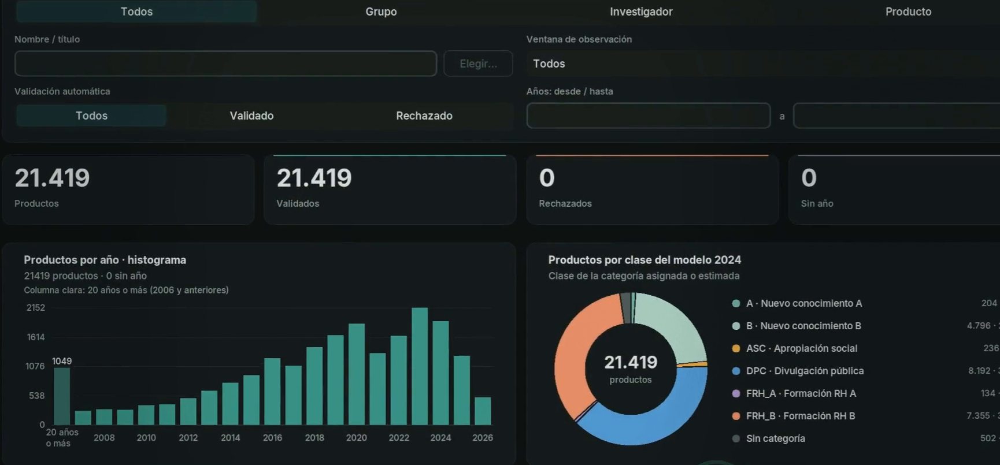
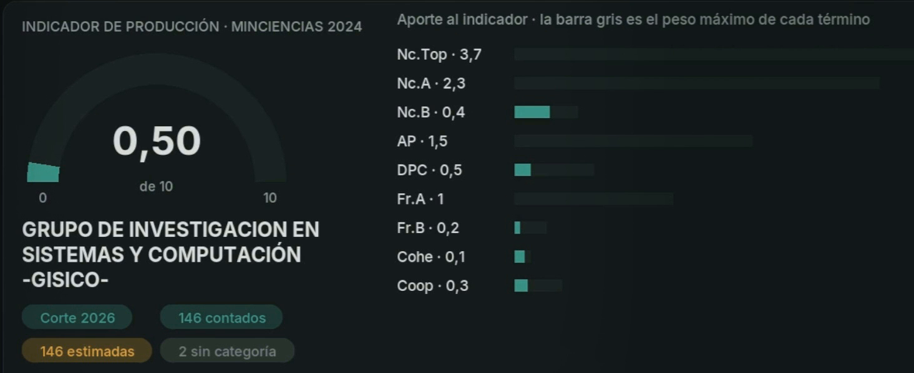
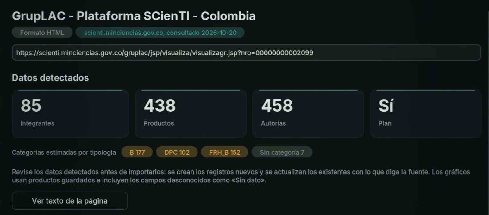

<p align="center">
  
</p>

<h1 align="center">PEA-i UPC</h1>

<p align="center">
  <strong>Research output manager for the Universidad Popular del Cesar.</strong><br>
  Groups, researchers and products from Minciencias' public records, with validation, charts and the 2024 production indicator.
</p>

<p align="center">
  <a href="#features">Features</a> &middot;
  <a href="#run-it">Run it</a> &middot;
  <a href="#production-indicator">Indicator</a> &middot;
  <a href="#data">Data</a> &middot;
  <a href="#tests">Tests</a> &middot;
  <a href="README.es.md">Español</a>
</p>

<p align="center">
  
  
  
  
  
</p>

---



PEA-i (*Programa Estadístico de Análisis de Investigación*) manages the
research activity of the Universidad Popular del Cesar: its research groups,
researchers, products, plans and the relations between them, captured from
the public GrupLAC and CvLAC records of Minciencias' ScienTI platform. It was
built for the **Data Structures** course of the Systems Engineering program,
where every record lives in lists, multilists, stacks and queues.

It ships as two cooperating programs: a **C++17 engine and console**, and a
**Python desktop app** with a CustomTkinter interface. The window drives the
C++ engine as a local process over JSON messages on `stdin`/`stdout`, and
falls back to its own Python engine when the C++ one cannot start. The
interface is in Spanish.

<table>
  <tr>
    <td width="50%"></td>
    <td width="50%"></td>
  </tr>
  <tr>
    <td align="center"><em>The Minciencias 2024 indicator for a group, term by term.</em></td>
    <td align="center"><em>Every import is previewed before it touches the data.</em></td>
  </tr>
</table>

## Features

- **Full CRUD on every record**: groups, researchers, products, plans and
  their relations are created, edited, deactivated and deleted from tables and
  record cards. **Ctrl+Z** undoes the last action from a stack of up to 30.
- **Dashboard and charts**: summaries, histograms and distributions in the
  *All*, *Group*, *Researcher* and *Product* views, filtered by years and by
  validation state.
- **Automatic validation**: a product is validated when it has a year, a
  type, an active author or group, and a valid URL or DOI.
- **Review queue**: rejected products are served first in, first out, and
  each review needs a note explaining the decision.
- **Production indicator**: the Minciencias 2024 model for any group or
  researcher, with the contribution of each term and a per-subtype detail.
- **Imports from many sources**: CSV, Excel `.xlsx`, public GrupLAC and CvLAC
  URLs, PDF with text and Word `.docx`, always with a preview. Imports add
  what is new and update what changed, without duplicating records.
- **One data file**: everything, including the review queue and the undo
  history, is saved to a single CSV, and every save leaves a copy in
  `.backup/`.

## Run it

Requires Python 3.10 or newer with Tkinter and CustomTkinter
(`requirements.txt`). If CustomTkinter is missing, PEA-i offers to install it
the first time it opens.

**Windows (64-bit)**: double-click **`Iniciar PEA-i.pyw`**, or run
`py -3 src/python/Taller2_REMR.py`. It uses the bundled
`bin/windows/pea_cpp.exe`, which is only accepted when its SHA-256 matches the
sources, so there is nothing to compile.

**Linux**:

```bash
python3 -m venv .venv
.venv/bin/pip install -r requirements.txt
.venv/bin/python src/python/Taller2_REMR.py
```

With CMake and a C++17 compiler installed, the window builds the C++ engine in
Release mode when it needs to.

**C++ console only**: `bin\windows\pea_cpp.exe` on Windows. On Linux:

```bash
cmake -S . -B build -DCMAKE_BUILD_TYPE=Release
cmake --build build --config Release
./build/pea_cpp
```

| Option | Effect |
|---|---|
| `--data FILE` | Open another data file. |
| `--python-backend` | Force the Python engine. |
| `--cpp-binary PATH` | Use another C++ executable. |

The engine in use is shown in **Ayuda → Acerca de PEA-i**.

## Production indicator

PEA-i computes the Minciencias 2024 indicator for a group or a researcher:

```
Ind = 3.7·Nc.Top + 2.3·Nc.A + 0.4·Nc.B + 1.5·AP + 0.5·DPC + 1·Fr.A + 0.2·Fr.B + 0.1·Cohe + 0.3·Coop
```

Each term is an index from 0 to 1 relative to the maximum among the active
entities loaded, so the indicator is at most 10. Each product contributes
according to its category, one of the model's 169 subtypes.

- **In the window**: **Importar → URL pública…**, paste the group's GrupLAC
  page or the researcher's CvLAC page, press **Importar datos detectados** and
  then **Ver indicador**. It also appears on the dashboard when a group or a
  researcher is selected.
- **Categories**: the importer estimates the lowest category of each family,
  because public records do not publish it. A category chosen by hand is kept
  on later imports.
- **C++ console**: option **12. Indicador**.

The complete calculation is in section 9 of the
[technical specification](docs/especificacion_tecnica.docx).

## Data

`data/pea_upc.csv` (captured on October 19, 2026) holds the 66 research
groups associated with the UPC in Minciencias' public search, with
**2,748 researchers** and **21,419 products**, plus their plans and relations.
Provenance, limits and how to refresh the capture are in
[data/README.md](data/README.md). Neither the automatic validation nor the
estimated categories are an official Minciencias validation or
classification.

## Tests

```bash
python3 -m unittest discover -s tests/python -v
cmake -S . -B build -DCMAKE_BUILD_TYPE=Release
cmake --build build --config Release
ctest --test-dir build --output-on-failure
```

On Windows use `py -3`. Interface tests need a graphical session and
CustomTkinter; to run them against the C++ engine, set
`PEA_TEST_CPP=build/pea_cpp`. Tests never modify `data/`.

## Videos

- [**PEA-i por dentro**](docs/video_taller.mp4) (Taller 2, 5 min): the stack and the queue, in the code and in the app.
- [**PEA-i: el indicador**](docs/video_parcial.mp4) (Parcial 2, 5 min): the Minciencias 2024 categories, how the indicator is computed and how to use it in the app.

## Repository layout

```text
Iniciar PEA-i.pyw                 Double-click launcher for Windows
src/cpp/Taller2_REMR.cpp          C++ console and engine
src/python/Taller2_REMR.py        Tkinter interface and standalone Python engine
bin/windows/                      64-bit C++ executable and integrity hashes
data/pea_upc.csv                  Single data file (public UPC capture)
data/README.md                    Data provenance and limits
docs/especificacion_tecnica.docx  Technical specification: model, structures, schema and protocol
docs/ENUNCIADO_TALLER_2.md        Assignment brief
docs/video_taller.mp4             Taller 2 video: stacks, queues and the interface
docs/video_parcial.mp4            Parcial 2 video: the production indicator
assets/pea-i/                     Logo and screenshots used in this README
scripts/                          Data, document and binary regeneration
tests/                            Domain, integration and load tests
CMakeLists.txt                    C++ build
```

---

<p align="center">
  Built by <strong>Rafael Miranda</strong> for the Data Structures course · Systems Engineering · Universidad Popular del Cesar
</p>
